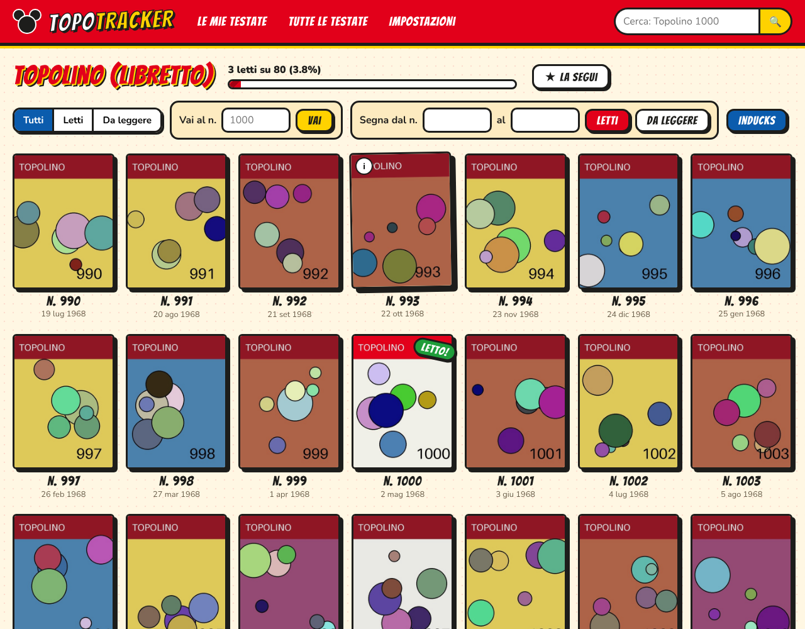

# TopoTracker

Tracker personale dei fumetti Disney italiani letti: Topolino libretto, almanacchi, Classici, Paperinik
e tutte le altre testate italiane censite da [I.N.D.U.C.K.S.](https://inducks.org).

- Copertina di ogni numero, in un'interfaccia in stile Topolino.
- Ogni numero si segna come **letto** o **da leggere** con un tocco, in qualsiasi ordine
  (puoi aver letto il Topolino 1000 e non il 1500).
- "Segna più numeri" per marcare un intervallo (es. dal 1 al 500) in un colpo solo.
- Ricerca rapida (`1000`, `topolino 2500`, `almanacco 12`), filtri letti / da leggere, "vai al numero".
- Statistiche per testata, backup e ripristino delle letture in JSON.



*(schermata con dati e copertine di prova)*

## Avvio con Docker

```bash
git clone https://github.com/land2595/topotracker.git
cd topotracker
docker compose up -d --build
```

Poi apri <http://localhost:8000>. Al primo avvio l'app scarica i dati da Inducks e li importa: servono alcuni
minuti (i file sono grandi), la pagina si aggiorna da sola quando ha finito.

Tutto quello che l'app salva sta nella cartella `./data`:

| Percorso | Contenuto |
|---|---|
| `data/topotracker.db` | database SQLite con testate, numeri e **le tue letture** |
| `data/isv/` | dump di Inducks scaricati |
| `data/covers/` | copertine già viste, ridotte e salvate in cache |

Per un backup basta copiare `data/topotracker.db`, oppure usare *Impostazioni → Scarica backup*.

## Da dove arrivano i dati

L'app **non fa scraping** del sito. Usa i dump ufficiali che Inducks mette a disposizione
(<https://inducks.org/inducks/isv/>):

- `inducks_publication.isv`: le testate (vengono tenute solo quelle italiane)
- `inducks_issue.isv`: i numeri di ogni testata
- `inducks_entryurl.isv` e `inducks_entry.isv`: per sapere quale immagine è la copertina di ogni numero

I dump vengono riscaricati ogni 7 giorni (configurabile). Le copertine vengono scaricate da outducks.org
**solo quando le guardi**, una volta sola, e poi servite dalla cache locale.

Se il download automatico non funziona (per esempio perché il sito blocca le richieste automatiche),
scarica a mano i quattro file `.isv` dall'indirizzo sopra, mettili in `data/isv/` e premi
*Impostazioni → Rileggi i file*.

I dati di Inducks sono curati da volontari: se trovi errori, correggili sul sito, e rispetta le
condizioni d'uso indicate da Inducks. Questo è un progetto personale, non affiliato
a Disney o Panini.

## Configurazione

Variabili d'ambiente (in `docker-compose.yml`):

| Variabile | Default | Significato |
|---|---|---|
| `DEFAULT_FOLLOWED` | `it/TL` | testate seguite al primo avvio (codici Inducks separati da virgola) |
| `UPDATE_INTERVAL_DAYS` | `7` | ogni quanti giorni riscaricare i dump; `0` = solo a mano |
| `AUTO_IMPORT` | `1` | importa automaticamente al primo avvio |
| `COUNTRY` | `it` | paese delle testate da importare |
| `INDUCKS_ISV_URL` | `https://inducks.org/inducks/isv/` | da dove scaricare i dump |
| `COVER_URL_TEMPLATE` | `https://outducks.org/{sitecode}/{url}` | indirizzo delle immagini di copertina |
| `THUMB_WIDTH` | `360` | larghezza delle copertine salvate in cache |

## Sviluppo

```bash
pip install -r requirements.txt pytest
DATA_DIR=./data uvicorn app.main:app --reload
pytest
```

Backend FastAPI + SQLite (`app/`), interfaccia in HTML/CSS/JS senza build (`app/static/`).
I font Bangers e Nunito sono inclusi (licenza SIL OFL).
